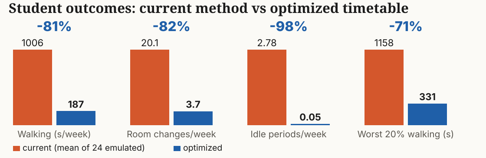
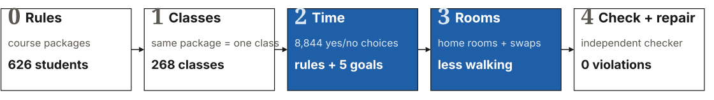
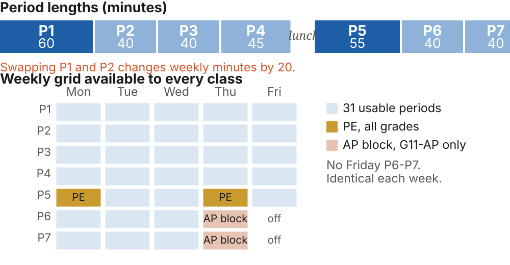
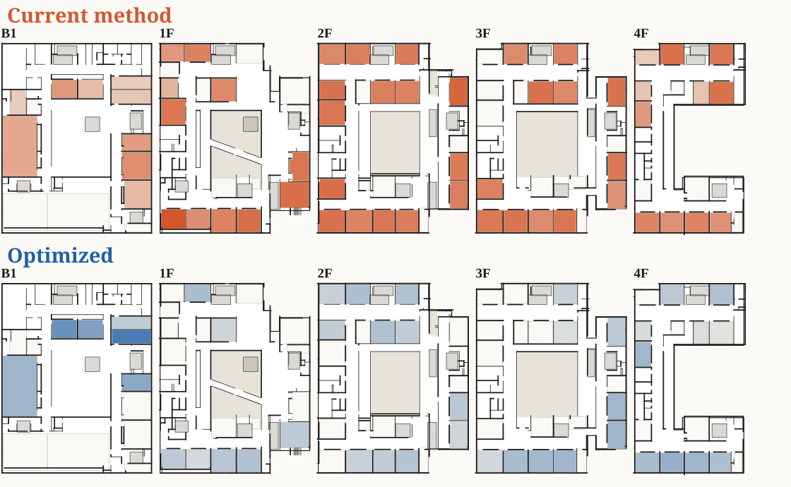
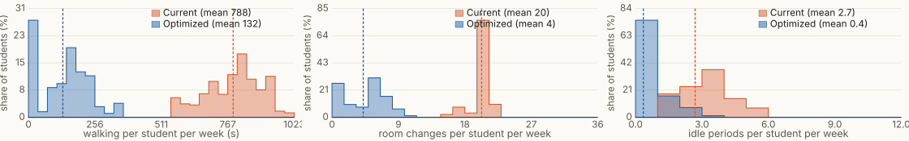
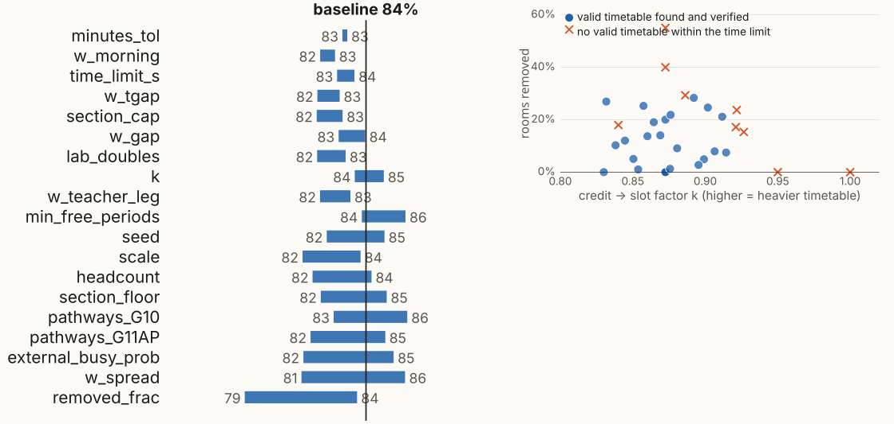

# Prompt 1: Optimizing School Curriculum

Automatic timetabling for a simulated school of 626 students (grades 9, 10 and 11 AP), 53 teachers and 59 rooms.
The scheduler assigns every lesson a period and a room, checks the result against ten hard constraints with an independent program,
and compares it with an emulation of the current method. The full write-up is the poster in `output/poster_large.pdf`.



| Per student, per week | Current | Optimized |
|---|---|---|
| Walking | 779 s | **132 s** |
| Room changes | 20.0 | **4.2** |
| Idle periods between lessons | 2.86 | **0.35** |
| Classes outside the weekly-minutes band | 109 of 268 | **0** |

Teachers' walking changes from 318 to 385 s per week and their idle periods from 6.8 to 4.0. Teachers move between rooms so that students do not.

## Assumptions

- The timetable is identical in every week; one week is planned and repeated.
- Floor B2 is for club activities only. No class is scheduled there, so it is removed from the room pool. All 14 laboratories are on B2, so the sciences meet in ordinary classrooms and keep a practical double period. The pool is 49 classrooms (1F to 4F) and 10 arts rooms (B1).
- Weekly lessons per course come from the catalog credit multiplied by a factor fitted on the one observed week (k = 0.873); the sensitivity runs vary it.
- The 626 students, 54 teachers and the current method are simulated. The only real timetable data is one observed week.

## Method



1. **Classes.** Students with the same course package form one class (at most 24). Free elective choice makes the conflict graph too dense to schedule (31 mutually exclusive lessons for 29 free periods), so a fixed set of packages is offered.
2. **Time.** CP-SAT assigns a period to every lesson. Hard constraints: no student, teacher or room used twice, teacher limits on consecutive lessons, practical double periods, and weekly minutes within 8% of nominal (periods are 40 to 60 minutes, so counting lessons alone changes class hours). The objective removes idle gaps, same-day repeats and late hard subjects.
3. **Rooms.** Each class gets a home room; remaining lessons are matched to free rooms and improved by annealing on total walking time from the building model.
4. **Check and repair.** A separate checker re-derives the ten constraints from the finished timetable. When a room closes, a teacher is absent or enrollment grows, only the affected lessons are re-planned.



## Results





Walking falls by 83%, room changes by 79% and idle periods by 88%. The worst-off 20% of students also improve (924 to 265 s), so the gain is not concentrated in a few students.

## Verification

The checker shares no code with the scheduler and finds 0 violations in the optimized timetable. The current-method timetables violate only the weekly-minutes rule (about 109 classes each). Ten injected faults, one per constraint, are all detected. 62 sensitivity runs were solved and checked again; 57 of them produced a timetable with no violation. `pytest tests/` runs 21 tests.

## Sensitivity



Across single-assumption changes the walking reduction stays between 78% and 83%. It is robust to objective weights, class-size limits, staffing and the solver seed. It does not survive a much heavier timetable or the loss of 40% of the rooms: no valid timetable was found for the current method or the optimized one.

## Repair

A teacher absence is covered by a qualified free colleague for 85% of lessons. A closed room moves its lessons to free rooms of the same kind, with no change of time. Over 12 draws of each event, the expected cost is 0.00 lessons re-timed and 20.6 room changes; all repaired timetables pass the checker.

## Limitations

- Only one real week exists; the current method is an emulator calibrated to it (about 18 room changes against 21 observed).
- CP-SAT stopped at its time limit, so "optimized" means the best feasible timetable found, not a proven optimum.
- Sections of the same course can still differ in weekly minutes; an equality constraint across sections is the next rule to add.

## Reproduce

```
python -m venv .venv && .venv/Scripts/pip install ortools numpy matplotlib pytest
cd src
PYTHONPATH=. python -m run 24 150          # main run
PYTHONPATH=. python -m sensitivity all     # sweeps (about 40 min on 12 cores)
PYTHONPATH=. python -m poster2             # poster -> output/poster_large.html
PYTHONPATH=. python -m readme              # this file and docs/img
cd .. && python -m pytest tests/test_tt.py
```

`submissions/` holds the thumbnail and eight evidence images. `src/` holds the pipeline, `src/config/tt.toml` every parameter, `docs/Question.txt` the prompt and `docs/improvement_proposal.md` the design rationale.
